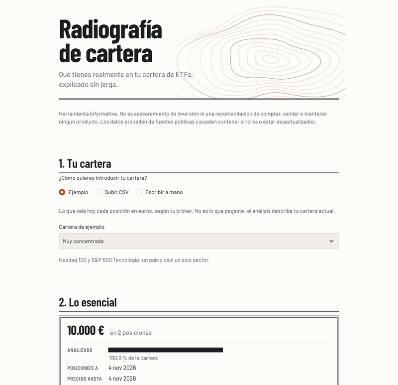
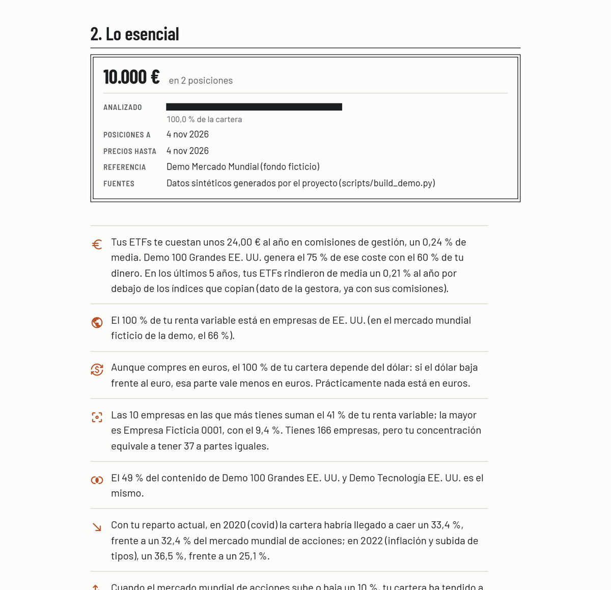
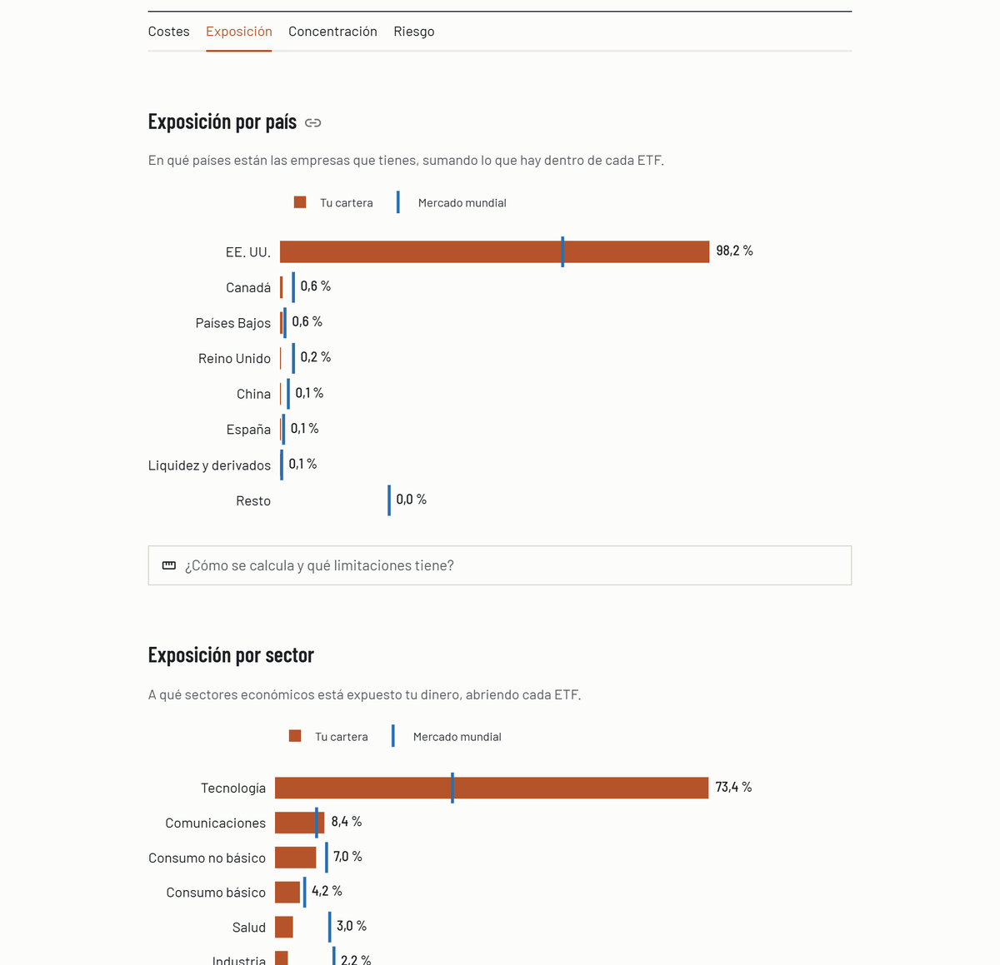
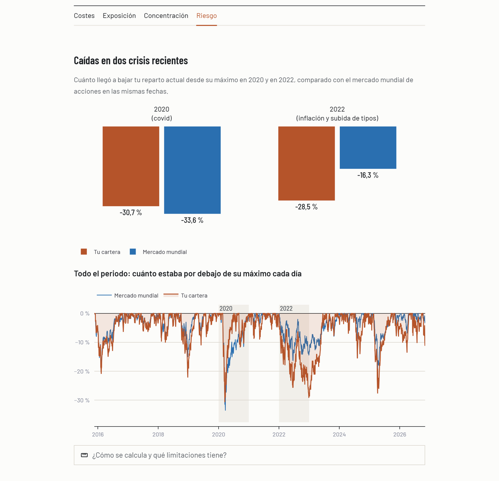
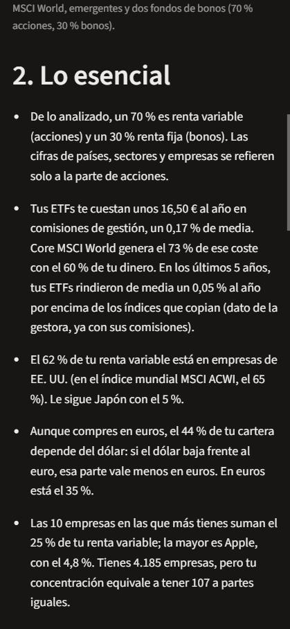

# Radiografía de cartera

**Qué tienes realmente en tu cartera de ETFs, explicado sin jerga.**

Analizador informativo para inversores particulares en España que gestionan su propia cartera
de ETFs: abre cada fondo, suma lo que hay dentro y cuenta en lenguaje claro dónde está tu dinero,
cuánto pagas y cuánto se ha movido.

> **No es asesoramiento de inversión.** No predice mercados ni recomienda comprar, vender o
> mantener ningún producto (MiFID II). Describe la cartera que introduces.



## El problema

Mucha gente compra dos o tres ETFs "para diversificar" sin saber que:

- un **MSCI World y un S&P 500 comparten el 71 %** de su contenido;
- comprar en euros no elimina el riesgo de divisa: con un World, **unos tres cuartos de la cartera
  dependen del dólar**;
- con 1.300 empresas en cartera, la concentración puede equivaler a tener **solo 68 a partes
  iguales**;
- la comisión anunciada (TER) no es lo que cuesta el fondo: a 5 años, el iShares Core S&P 500
  rindió **+0,17 % al año por encima** de su índice pese a cobrar un 0,07 %.

Esta herramienta lo calcula con los datos que publican las propias gestoras y lo explica.

## Qué muestra

1. **Tu cartera:** tres carteras de ejemplo (global diversificada, muy concentrada, con fondos
   solapados), un CSV (formato de Excel en español o en inglés) o un formulario. Un ISIN con
   errata se detecta por su dígito de control; un ETF fuera del universo se marca como "no
   cubierto" con su peso, sin inventar nada.
2. **Lo esencial:** un resumen en frases, generado con plantillas a partir de las cifras.
3. **En detalle**, en cuatro pestañas:
   - **Costes:** TER ponderado, coste anual en euros y diferencia real con el índice.
   - **Exposición:** por país, sector y divisa, abriendo cada ETF (*look-through*).
   - **Concentración:** las 10 mayores empresas, número efectivo de empresas y solapamiento
     entre cada par de ETFs.
   - **Riesgo:** cuánto habría caído tu cartera en **2020 y 2022 comparado con el mercado
     mundial** en las mismas fechas, volatilidad, sensibilidad al mercado (beta) y la rentabilidad
     de los últimos 5 años como contexto. VaR, alpha con su rango y máxima caída quedan como
     medidas técnicas.

Cada cifra lleva una explicación de una línea y un desplegable con cómo se calcula, sus
limitaciones, el periodo y la fecha del dato. Funciona en el móvil.

| Resumen | Exposición | Riesgo | Móvil |
|---|---|---|---|
|  |  |  |  |

## Cómo está hecho

```
scripts/ (descarga offline) ──► data/snapshots/<fecha>/   (fuera de git)
                                         │
src/radiografia/                         ▼
  input/       lectura y validación de la cartera (ISIN, CSV en dos formatos)
  data/        adaptadores iShares y BCE, universo de fondos, snapshots
  analytics/   costes, look-through, rentabilidades, riesgo (funciones puras)
  reporting/   textos, resumen con plantillas, formato en español
  service.py   analyze(cartera) -> AnalysisReport   ← único punto de entrada
                                         │
app/streamlit_app.py ── solo presentación ┘
```

- **Motor en Python separado de la interfaz.** La app no calcula nada; todo sale de
  `service.analyze()`, que devuelve un informe serializable a JSON (listo para una API FastAPI o un
  PDF).
- **Cada métrica es un `MetricResult`:** valor, estado (disponible, parcial o no disponible),
  cobertura de la cartera, intervalo de incertidumbre, periodo, fecha del dato y avisos.
- **Nada se inventa:** si falta un dato, la métrica sale como "no disponible" o "parcial" con el
  porcentaje de cartera afectado.
- **Datos descargados offline;** la app nunca consulta fuentes externas mientras la usas.
- **Privacidad:** la cartera solo vive en la memoria de la sesión; no se guarda ni se envía a
  ningún servicio, y las estadísticas de uso de Streamlit están desactivadas.

Stack: Python 3.12, pandas, numpy, pydantic, Streamlit, plotly, pytest, ruff.

## Validación contra las gestoras

Lo que se puede contrastar se contrasta con lo que publica iShares, con tolerancias derivadas de
su propio redondeo (no ajustadas para que pasen). Detalle en [docs/VALIDACION.md](docs/VALIDACION.md).

| Qué | Resultado |
|---|---|
| Desglose por sector y país de cada ETF | 19 comparaciones coinciden (diferencia máx. 0,006 puntos); 4 discrepancias explicadas |
| Rentabilidad anual de los 15 ETFs, 5 años cada uno | 15 de 15 coinciden |
| Volatilidad a 3 años de los 15 ETFs | 15 de 15 coinciden (MSCI World: 11,62 % publicado y calculado) |

Las discrepancias están documentadas y fijadas en los tests como fallos esperados: si un día
cuadran, el test avisa para revisar la explicación.

## Ejecutarla en local

Requiere Python 3.12.

```bash
py -3.12 -m venv .venv
.venv\Scripts\python -m pip install -e ".[dev]"
.venv\Scripts\python scripts\build_holdings.py
.venv\Scripts\python scripts\build_prices.py
.venv\Scripts\streamlit run app\streamlit_app.py
```

(En Linux/macOS, `.venv/bin/` en lugar de `.venv\Scripts\`.)

Los dos scripts descargan los datos de iShares y del BCE a `data/` (fuera del repositorio). Sin
ellos la app funciona igual, pero solo con los costes: el resto aparece como "no disponible".

```bash
.venv\Scripts\python -m pytest -m "not validation"
.venv\Scripts\python -m pytest -m validation
```

El primero son los tests que corren en la CI (229, sin red ni datos externos). El segundo, la
validación con datos reales (67 más, con la copia local).

## Datos y licencias

| Fuente | Uso | Condiciones |
|---|---|---|
| iShares (BlackRock) | Posiciones, desgloses, TER, valores liquidativos, repartos | Uso personal y no comercial; reproducir o mostrar sus datos requiere autorización |
| BCE | Tipos de cambio y €STR | Reutilización libre citando la fuente |
| Yahoo Finance | — | Descartado: sus términos prohíben el acceso automatizado y la redistribución |

Por eso **no hay URL pública**: los datos de iShares no están en el repositorio y la app se
ejecuta en local, con datos que cada usuario descarga para su uso personal. Las capturas de este
README muestran cifras derivadas de esos datos. Detalle y fuentes consultadas en
[docs/FUENTES_Y_LICENCIAS.md](docs/FUENTES_Y_LICENCIAS.md).

## Limitaciones

- **Universo cerrado:** 15 ETFs UCITS de iShares (12 de renta variable, 3 de renta fija). Los
  fondos indexados no cotizados, muy usados en España, y los ETFs de otras gestoras no están.
- **Los bonos no se abren:** cuentan para la divisa, los costes y el riesgo, pero no para país,
  sector o empresas.
- **Las posiciones son una foto** con fecha. El país es el domicilio de cada empresa, no de dónde
  vienen sus ingresos, y la divisa es la de cotización.
- **Clases cubiertas en divisa:** se suponen cubiertas al 100 %, porque las posiciones no
  permiten calcular la cobertura real.
- **El riesgo es histórico y simulado:** aplica los pesos de hoy al pasado. El periodo empieza
  cuando empezó a cotizar el ETF más joven, así que la crisis de 2008 no está.
- **Alpha:** casi siempre indistinguible de cero en ETFs indexados, y no se muestra si la renta
  variable pesa menos del 80 %.
- **Sin impuestos:** no calcula plusvalías ni tiene en cuenta que en España vender un ETF tributa.

## Documentación

- [docs/GLOSARIO.md](docs/GLOSARIO.md): cada concepto (ISIN, TER, look-through, volatilidad,
  VaR, beta, alpha…) explicado con ejemplos reales.
- [docs/METODOLOGIA.md](docs/METODOLOGIA.md): fórmulas, ventanas, supuestos y limitaciones de
  cada métrica.
- [docs/VALIDACION.md](docs/VALIDACION.md): resultados de la validación contra la gestora.
- [docs/FUENTES_Y_LICENCIAS.md](docs/FUENTES_Y_LICENCIAS.md): fuentes, licencias y decisión de
  despliegue.

## Estado y siguientes fases

MVP completo en local. Próximas fases, sin implementar:

1. Escenarios condicionales, siempre con rangos y nunca con una cifra única.
2. Comportamiento en crisis pasadas (2000-02, 2008, 2020, 2022) con índices o factores.
3. Informe en PDF a partir del mismo informe JSON.

Licencia del código: pendiente de decidir antes de hacer público el repositorio.
