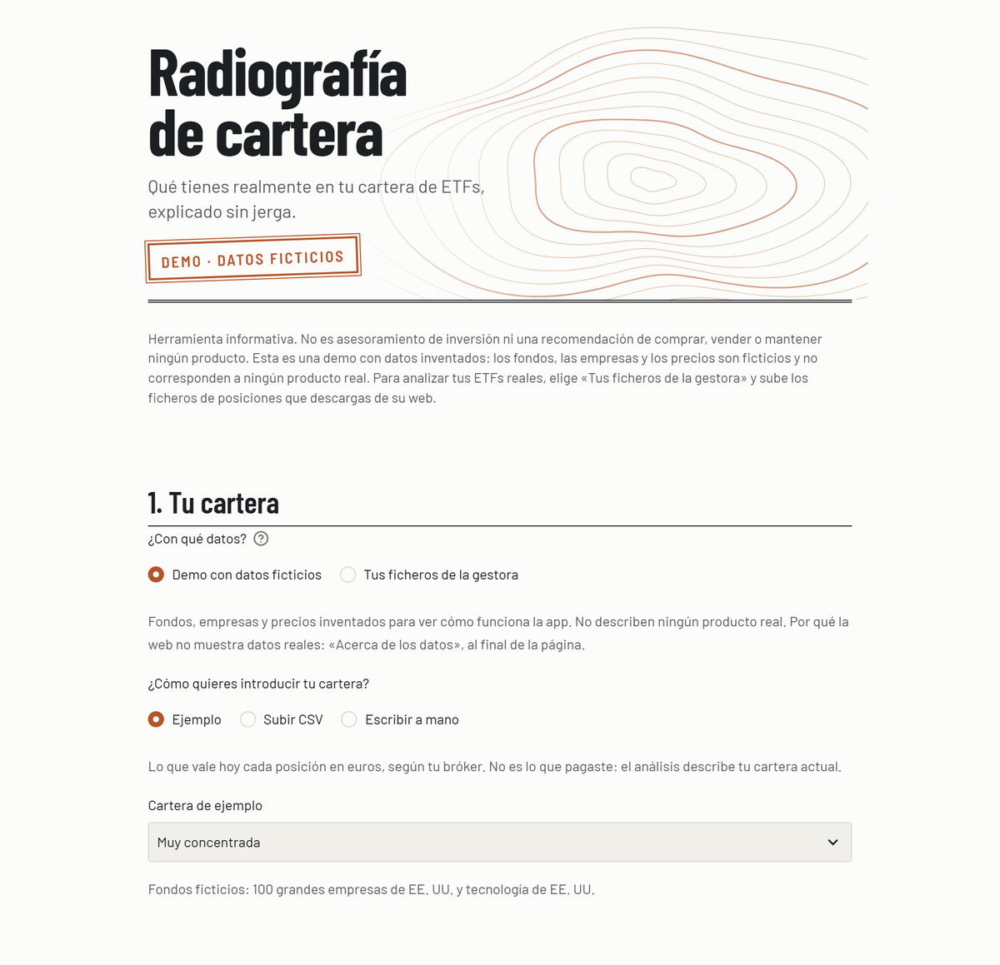

# Radiografía de cartera

**Qué tienes realmente en tu cartera de ETFs, explicado sin jerga.**

Analizador informativo para inversores particulares en España que gestionan su propia cartera
de ETFs: abre cada fondo, suma lo que hay dentro y cuenta en lenguaje claro dónde está tu dinero,
cuánto pagas y cuánto se ha movido.

> **No es asesoramiento de inversión.** No predice mercados ni recomienda comprar, vender o
> mantener ningún producto (MiFID II). Describe la cartera que introduces.


*Demo con datos inventados, cartera de ejemplo "Muy concentrada". Ni las capturas ni el GIF
muestran datos reales.*

**Pruébala: [radiografia-cartera.streamlit.app](https://radiografia-cartera.streamlit.app)**,
una demo con fondos, empresas y precios ficticios. Para tus ETFs reales, en la misma web puedes
subir el fichero de posiciones que descargas de tu gestora; o ejecutar la app en local. Por qué
no hay una web con datos reales: [Datos](#datos-por-qué-no-hay-una-url-pública-con-datos-reales).

## Para quién

Para quien invierte por su cuenta con dos, tres o cuatro ETFs y quiere saber qué tiene de verdad:
qué países y empresas hay detrás, cuánto depende del dólar, si sus fondos se repiten y cuánto le
cuestan. No hace falta saber de finanzas: cada cifra lleva una frase que la explica.

## El problema

Mucha gente compra varios ETFs "para diversificar" sin saber que:

- un **MSCI World y un S&P 500 comparten el 71 %** de su contenido;
- comprar en euros no elimina el riesgo de divisa: con un World, **unos tres cuartos de la cartera
  dependen del dólar**;
- una cartera de 60 % MSCI World, 30 % S&P 500 y 10 % World cubierto tiene 1.300 empresas,
  pero su concentración equivale a tener **solo 68 a partes iguales**;
- la comisión anunciada (TER) no es lo que cuesta el fondo: a 5 años, el iShares Core S&P 500
  rindió **+0,17 % al año por encima** de su índice pese a cobrar un 0,07 %.

> Las cifras de ejemplo de este README y de `docs/` salen de datos publicados por iShares
> (BlackRock), con posiciones a 4-nov-2026, o de cálculos propios hechos con ellos. Se
> reproducen como ejemplos puntuales para explicar la herramienta; los datos pertenecen a su
> titular y pueden haber cambiado.

## Qué muestra

1. **Tu cartera:** primero eliges con qué datos (la demo, tus ficheros de la gestora o, en local,
   tus datos descargados); después, una cartera de ejemplo (global, muy concentrada, con fondos
   solapados), un CSV (formato de Excel en español o en inglés) o un formulario. Un ISIN con
   errata se detecta por su dígito de control; un ETF fuera del universo se marca como "no
   cubierto" con su peso, sin inventar nada.
2. **Lo esencial:** la cartela de datos (cuánto se ha analizado, de qué fecha son las posiciones
   y un aviso si tienen más de un mes) y un resumen en frases generado con plantillas.
3. **En detalle**, en cuatro pestañas:
   - **Costes:** TER ponderado, coste anual en euros y diferencia real con el índice.
   - **Exposición:** tu cartera frente al mercado mundial en cuatro cifras, y el desglose por
     país, sector y divisa abriendo cada ETF (*look-through*), con el mercado mundial marcado al
     lado en la misma escala.
   - **Concentración:** las 10 mayores empresas, número efectivo de empresas y solapamiento entre
     cada par de ETFs, también de gestoras distintas.
   - **Riesgo:** cuánto habría caído tu cartera en **2020 y 2022 comparado con el mercado
     mundial**, volatilidad, sensibilidad al mercado (beta) y la rentabilidad de los últimos 5
     años como contexto. VaR, alpha con su rango y máxima caída quedan como medidas técnicas.
4. **Acerca de los datos:** una página que explica de dónde salen los datos y por qué la web
   pública no muestra datos reales.

Cada cifra lleva una explicación de una línea y un desplegable con cómo se calcula, sus
limitaciones, el periodo y la fecha del dato. Funciona en el móvil.

| Tu cartera | Resumen | Exposición | Riesgo | Móvil |
|---|---|---|---|---|
|  |  |  |  |  |

## Datos: por qué no hay una URL pública con datos reales

*Revisión de las condiciones de uso hecha el 5 y el 7 de noviembre de 2026. Es mi lectura de
textos públicos, no asesoramiento jurídico. Detalle y citas en
[docs/FUENTES_Y_LICENCIAS.md](docs/FUENTES_Y_LICENCIAS.md).*

Para analizar qué contiene un fondo hacen falta sus **posiciones**: la lista completa de lo que
tiene. En mi revisión no encontré una forma sencilla, oficial y conforme a las condiciones de
uso de obtener las posiciones de ETFs y fondos europeos para mostrarlas en una web pública:

- **Las gestoras** (iShares, Vanguard, Xtrackers, Amundi, SPDR, Invesco) publican sus ficheros
  para uso personal y piden autorización para reproducir o mostrar sus datos; algunas prohíben
  además la descarga automática.
- **Yahoo Finance** prohíbe el acceso automatizado y la redistribución.
- **Los proveedores de pago** que revisé (EODHD, Financial Modeling Prep) limitan su plan
  estándar al uso personal y exigen una licencia o un acuerdo para mostrar datos a terceros.
- **Los reguladores** publican datos útiles, pero limitados: la **SEC**, la composición completa
  de los fondos de EE. UU. (no de los UCITS europeos); la **CNMV**, las carteras trimestrales de
  los fondos y SICAV españoles (no de los ETFs domiciliados en Irlanda o Luxemburgo).

Por eso el proyecto se queda así:

| Modo | Datos | Dónde |
|---|---|---|
| **Demo** | Sintéticos: 8 fondos y unas 1.200 empresas inventadas ([scripts/build_demo.py](scripts/build_demo.py), semilla fija). Ningún dato de terceros. | [Web pública](https://radiografia-cartera.streamlit.app) y local |
| **Tus ficheros de la gestora** | El fichero de posiciones que cada usuario descarga de la ficha de su ETF (iShares, Xtrackers, Amundi o SPDR) y sube. Se lee en memoria y no se guarda. Sin precios, así que sin riesgo. | Web pública y local |
| **Datos locales** | iShares y BCE, descargados para uso personal con los scripts del proyecto. Todo, riesgo incluido. | Solo en local |
| **Modo SEC** | Composición del ETF de EE. UU. que replica el mismo índice (formulario N-PORT), con el error medido: 0–2 puntos en el peso de las 10 mayores empresas. | Solo en local (`app/public.py`) |

El motor es el mismo en los cuatro casos.

## Ejecutarla en local

Requiere Python 3.12.

```bash
py -3.12 -m venv .venv
.venv\Scripts\python -m pip install -e ".[dev]"
.venv\Scripts\streamlit run app\streamlit_app.py
```

(En Linux/macOS, `.venv/bin/` en lugar de `.venv\Scripts\`.)

Sin datos descargados, la app arranca en la demo y permite subir tus ficheros de la gestora.
Para tener también los datos de iShares y del BCE en local (quedan en `data/`, fuera del
repositorio):

```bash
.venv\Scripts\python scripts\build_holdings.py
.venv\Scripts\python scripts\build_prices.py
```

Tests:

```bash
.venv\Scripts\python -m pytest -m "not validation"
.venv\Scripts\python -m pytest -m validation
```

El primero son los tests de la CI (324, sin red ni datos externos; con la demo y los datos
públicos de la SEC recorren todas las secciones de principio a fin). El segundo es la
validación contra las gestoras (71 tests) y **necesita datos reales locales**: la copia de
iShares que descargan los scripts y, para Xtrackers, Amundi y SPDR, un fichero de posiciones de
cada una descargado a mano en `data/raw/muestras/`. Sin esos datos, esos tests se saltan.

## Cómo está hecho

```
scripts/ (descarga offline) ──► data/snapshots/<fecha>/   (fuera de git)
                                         │
src/radiografia/                         ▼
  input/       cartera (ISIN, CSV en dos formatos) y ficheros de posiciones subidos
  data/        universo de fondos, snapshots, conjuntos de datos (demo, local, SEC, subidos)
    sources/   un lector por fuente detrás de HoldingsSource: iShares, Xtrackers, Amundi,
               SPDR, SEC N-PORT, BCE; lector de .xlsx propio
  analytics/   costes, look-through, misma empresa entre gestoras, rentabilidades, riesgo,
               antigüedad de los datos (funciones puras)
  reporting/   textos, resumen con plantillas, formato en español
  service.py   analyze(cartera) -> AnalysisReport   ← único punto de entrada
                                         │
app/streamlit_app.py ── solo presentación ┘   (app/demo.py y app/public.py la reutilizan)
```

- **Motor en Python separado de la interfaz.** La app no calcula nada; todo sale de
  `service.analyze()`, que devuelve un informe serializable a JSON (listo para una API o un PDF).
- **Cada métrica es un `MetricResult`:** valor, estado (disponible, parcial o no disponible),
  cobertura de la cartera, intervalo de incertidumbre, periodo, fecha del dato y avisos.
- **Nada se inventa:** si falta un dato, la métrica sale como "no disponible" o "parcial" con el
  porcentaje de cartera afectado.
- **Datos offline:** la app nunca consulta fuentes externas mientras la usas.
- **Privacidad:** la cartera y los ficheros solo viven en la memoria de la sesión; no se guardan
  ni se envían a ningún servicio, y las estadísticas de uso de Streamlit están desactivadas.

Stack: Python 3.12, pandas, numpy, pydantic, Streamlit, plotly, pytest, ruff. Diseño: la cartera
como una hoja de mapa topográfico ([DESIGN.md](DESIGN.md)).

## Decisiones principales

Todas, con fecha, en la tabla de decisiones de [CLAUDE.md](CLAUDE.md). Las que más condicionan
el resultado:

- **Solo ETFs UCITS en euros**; los fondos indexados no cotizados quedan fuera.
- **El resumen se escribe con plantillas** a partir de cifras ya calculadas, sin modelo de
  lenguaje; solo aparecen frases con dato y se compara únicamente con el mercado mundial.
- **Riesgo con los pesos de hoy aplicados al pasado:** no es la rentabilidad real del usuario y
  la app lo dice; las caídas se muestran en dos episodios fijos (2020 y 2022) para que dos
  carteras sean comparables.
- **Tras la [auditoría](AUDITORIA.md)** se rebajaron las métricas que inducían a error (máxima
  caída de toda la ventana, VaR, alpha) a un desplegable de medidas técnicas.
- **Gestoras sin descarga automática:** de Xtrackers, Amundi y SPDR solo se lee el fichero que
  sube el usuario.

## Validación

Lo que se puede contrastar se contrasta con lo que publica cada gestora, con tolerancias
derivadas de su propio redondeo (no ajustadas para que pasen). Todo requiere datos reales
locales (ver arriba). Detalle en [docs/VALIDACION.md](docs/VALIDACION.md).

| Qué | Resultado |
|---|---|
| Desglose por sector y país de cada ETF de iShares | 19 comparaciones coinciden (diferencia máx. 0,006 puntos); 4 discrepancias explicadas |
| Rentabilidad anual de los 15 ETFs de iShares, 5 años cada uno | 15 de 15 coinciden |
| Volatilidad a 3 años de los 15 ETFs de iShares | 15 de 15 coinciden (MSCI World: 11,62 % publicado y calculado) |
| Misma empresa entre gestoras: ETF del mismo índice de Xtrackers, Amundi y SPDR frente al de iShares | Solapamiento del 97,3 %, 94,6 % y 92,0 % |
| Modo SEC: gemelo de EE. UU. frente a los datos exactos de iShares | 0–2 puntos en el peso de las 10 mayores empresas |
| Subir los CSV de iShares frente a los datos descargados | Mismo análisis |

Las discrepancias están documentadas y fijadas en los tests como fallos esperados: si un día
cuadran, el test avisa para revisar la explicación.

## Limitaciones

- **Universo cerrado:** 18 ETFs UCITS: 15 de iShares (12 de renta variable, 3 de renta fija) y
  uno de Xtrackers, Amundi y SPDR, que solo se analizan subiendo su fichero (sin precios ni
  riesgo). Vanguard, Invesco y los fondos indexados no cotizados, muy usados en España, no están.
- **Los bonos no se abren:** cuentan para la divisa, los costes y el riesgo, pero no para país,
  sector o empresas.
- **Las posiciones son una foto** con fecha. El país es el domicilio de cada empresa, no de dónde
  vienen sus ingresos, y la divisa es la de cotización.
- **Entre gestoras,** las empresas que cambiaron de nombre o se abrevian distinto no siempre se
  reconocen como la misma, así que el solapamiento sale algo por debajo del real.
- **Clases cubiertas en divisa:** se suponen cubiertas al 100 %.
- **El riesgo es histórico y simulado:** aplica los pesos de hoy al pasado; la crisis de 2008
  no está.
- **Sin impuestos:** no calcula plusvalías ni tiene en cuenta que en España vender un ETF tributa.

## Documentación

- [docs/GLOSARIO.md](docs/GLOSARIO.md): cada concepto (ISIN, TER, look-through, volatilidad,
  VaR, beta, alpha…) explicado con ejemplos.
- [docs/METODOLOGIA.md](docs/METODOLOGIA.md): fórmulas, ventanas, supuestos y limitaciones.
- [docs/VALIDACION.md](docs/VALIDACION.md): resultados de la validación contra las gestoras.
- [docs/FUENTES_Y_LICENCIAS.md](docs/FUENTES_Y_LICENCIAS.md): fuentes, condiciones de uso y
  decisión de despliegue.
- [AUDITORIA.md](AUDITORIA.md): valoración crítica del resultado.
- [docs/DESPLIEGUE.md](docs/DESPLIEGUE.md): cómo se despliega la demo.

## Estado y siguientes fases

v1 cerrada: motor completo, uso local, modo "sube tu fichero" y demo pública. Próximas fases,
sin implementar:

1. Escenarios condicionales, siempre con rangos y nunca con una cifra única.
2. Crisis anteriores a los ETFs (2000-02, 2008) con índices o factores.
3. Informe en PDF a partir del mismo informe JSON.

## Licencia

El código y la documentación de este repositorio se publican bajo licencia MIT (ver
[LICENSE](LICENSE)).

La licencia **no cubre datos de terceros**:

- Las posiciones, comisiones, valores liquidativos y demás datos de las gestoras pertenecen a
  sus titulares y se rigen por sus condiciones de uso. Los metadatos de `data/reference/` (TER,
  índice, fechas y bolsas de los 18 ETFs del universo) se transcribieron de los documentos
  públicos de cada gestora, con fuente y fecha, y tampoco quedan bajo la licencia MIT.
- Los tipos de cambio y el €STR proceden del BCE; la composición del modo SEC, de la SEC.
- La tipografía Barlow tiene su propia licencia (SIL Open Font License 1.1,
  [app/static/fonts/OFL.txt](app/static/fonts/OFL.txt)).

El repositorio no incluye posiciones ni precios de las gestoras: los scripts los descargan para
el uso personal de quien los ejecuta. Las capturas y los datos de `data/demo/` son inventados y
quedan bajo la licencia MIT.

## In English

**Radiografía de cartera** ("portfolio X-ray") is an informational analyser for retail investors
in Spain who build their own portfolio of UCITS ETFs. It opens each fund, adds up what is inside
and explains in plain Spanish where the money is (countries, sectors, currencies, companies), how
much the funds overlap, what they cost and how the portfolio would have behaved in 2020 and 2022
next to the world market. It does not give investment advice or recommendations.

- **Engine:** Python 3.12, pandas and pydantic, separate from the Streamlit interface; one entry
  point returns a JSON-serialisable report; every metric carries its coverage, period, data date
  and caveats, and missing data is reported, never filled in.
- **Data:** a fund's holdings are needed to analyse it, and in my review (Nov 2026, not legal
  advice) I found no simple, official and terms-compliant way to show the holdings of European
  ETFs on a public website. So the public URL runs on synthetic data, users can upload the
  holdings file they download from their issuer (iShares, Xtrackers, Amundi, SPDR; read in
  memory, never stored), the full version runs locally on data each user downloads, and a local
  mode approximates each ETF with the SEC filings of the US ETF tracking the same index.
- **Validation:** results are checked against what issuers publish (country and sector
  breakdowns, yearly returns, 3-year volatility), with tolerances derived from their rounding;
  324 CI tests plus 71 validation tests that need local data.
- **Licence:** MIT for the code; third-party data are not covered.
